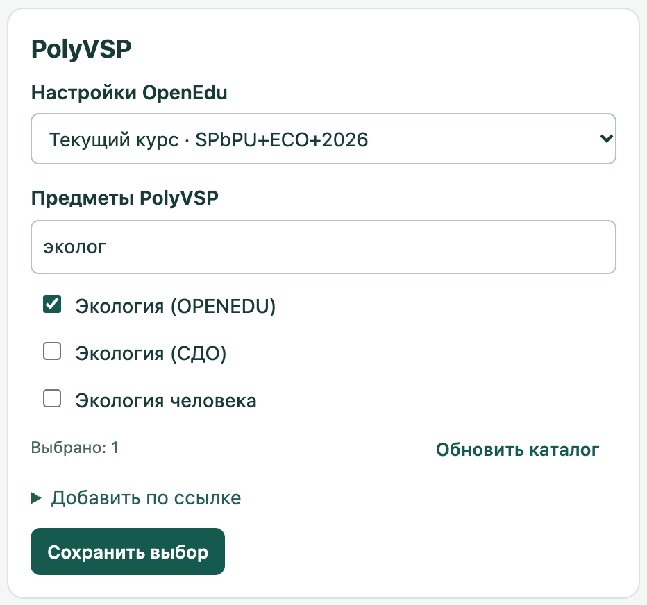
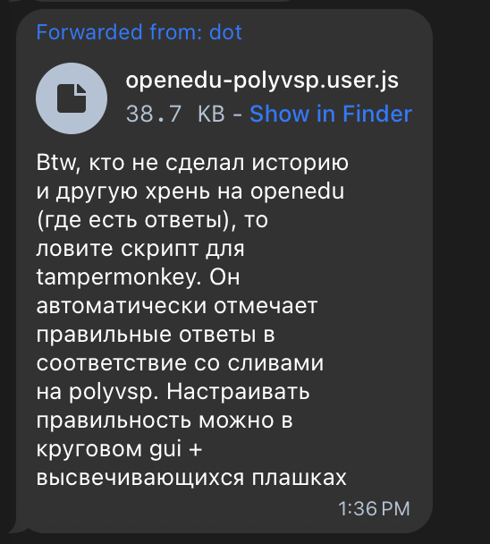

<div align="center">
  
  <h1>SyncShare</h1>
  <p>Подсказки из PolyVSP и SkipEdu в одной панели для OpenEdu и Moodle.</p>
  <p><a href="#install">Установка</a> · <a href="#courses">Выбор предмета</a> · <a href="#credits">Авторы</a></p>
</div>

| Платформа | Откуда берутся ответы | Что можно заполнить |
| --- | --- | --- |
| **OpenEdu** | Страницы выбранных предметов PolyVSP и база SkipEdu | Текстовые поля, списки, одиночный и множественный выбор |
| **Moodle** | База SkipEdu | Варианты, пропуски, сопоставления и перетаскивание слов в текст (`ddwtos`) |

<a id="install"></a>
## Готовые расширения

**[Скачать для Chrome (.zip)](https://github.com/axol0ttl/syncshare/releases/latest/download/syncshare-chrome.zip)** · **[Скачать для Firefox (.xpi)](https://github.com/axol0ttl/syncshare/releases/latest/download/syncshare-firefox.xpi)** · [Все релизы](https://github.com/axol0ttl/syncshare/releases)

- **Chrome** — распакуйте `syncshare-chrome.zip`, включите режим разработчика на `chrome://extensions` и нажмите **Загрузить распакованное расширение**. Выберите папку, в которой лежит `manifest.json`.
- **Firefox** — скачайте `syncshare-firefox.xpi`. Для временной установки откройте `about:debugging#/runtime/this-firefox`, нажмите **Загрузить временное дополнение** и выберите файл XPI. Эта сборка без подписи Mozilla действует до перезапуска браузера.

GitHub Actions публикует оба файла после успешной проверки каждого пуша. Основная ветка выпускает обычные релизы, остальные ветки — предварительные.

## Установка из исходников

Для сборки нужен Node.js 22 или новее. Запустите в каталоге проекта

```sh
npm ci
npm run build:chrome
```

**Chrome.** Откройте `chrome://extensions`, включите режим разработчика, нажмите **Загрузить распакованное расширение** и выберите папку `dist`.

**Firefox.** Выполните `npm run build:firefox`. На странице `about:debugging#/runtime/this-firefox` нажмите **Загрузить временное дополнение** и выберите `dist/manifest.json`. Обе команды сборки используют папку `dist`.

<a id="courses"></a>
## Выбор предмета на OpenEdu

1. На странице задания откройте **SyncShare → Настройки**. Расширение определит текущий курс OpenEdu.
2. В разделе **PolyVSP** введите часть названия предмета. Отметьте нужные страницы в каталоге и нажмите **Сохранить выбор**. Для курса можно выбрать несколько предметов.
3. Вернитесь к заданию. Откройте подсказку, чтобы выбрать ответ, или нажмите **Заполнить пропуски**, чтобы заполнить пустые поля текущей страницы. Готовую попытку отправляете вы.



Пункт **По умолчанию для всех курсов** задаёт общий набор предметов. Сохранённый каталог доступен при перебоях связи. Кнопка **Обновить каталог** загружает свежий список.

### Подключение SkipEdu

Введите ключ своей учётной записи в разделе **SkipEdu** и нажмите **Подключить**. Когда на OpenEdu обе базы находят ответ, SyncShare предлагает выбрать предпочитаемый источник и запоминает его. Другие ответы остаются в раскрывающемся меню вопроса. Предпочтение можно изменить в настройках.

<details>
<summary>Разработка и проверка</summary>

| Команда | Назначение |
| --- | --- |
| `npm run dev:chrome` | Пересобирать Chrome-расширение при изменениях |
| `npm run dev:firefox` | Пересобирать Firefox-расширение при изменениях |
| `npm test` | Собрать расширение для Chrome и проверить выбор предмета, источники и заполнение полей |

</details>

<a id="credits"></a>
## Авторы и благодарности

Оригинальный **SyncShare** для Moodle создал **Анатолий Машкин (Naloaty)**. Эта версия развивает его проект и добавляет интеграции с OpenEdu, PolyVSP и SkipEdu. [Оригинальный репозиторий](https://github.com/Naloaty/syncshare-extension) · [Сайт SyncShare](https://syncshare.naloaty.me/) · [Лицензия MIT](LICENSE.md)

**OpenAI Codex** участвовал в разработке этой версии: объединил источники ответов, добавил выбор предметов PolyVSP и тесты для заполнения заданий.

Отдельная благодарность анонимному участнику, который поделился скриптом Tampermonkey для OpenEdu и PolyVSP.



<details>
<summary>Скриншоты оригинального SyncShare</summary>


</details>
